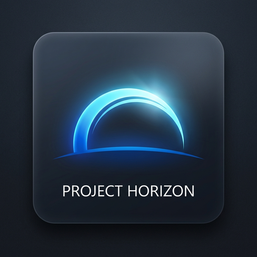

# Project Horizon



Horizon is a Windows desktop assistant for asking questions about your screen or documents, finding local projects, and opening them in VS Code. A global shortcut opens a small prompt over the app you are using. You can ask a text-only question, select part of the screen, attach the full display, or choose a PDF, image or text/code file. Answers stream into the floating assistant; the workspace keeps your chats and shows the execution trace for actions.

The latest source version is **1.1.5** for Windows 10/11 (x64), with hosted answers and no account or invite-code setup. Live text, image and PDF answers passed in the packaged app on 13 October 2026. The previous shared-key installers have been withdrawn. See the [changelog](CHANGELOG.md) for changes and validation.

## Install

**Installer withdrawal — 12 October 2026:** The friends installers for versions 1.1.1–1.1.4 and their checksum files have been removed from GitHub releases because they contained an owner-provided Gemini credential. That credential has been revoked. Existing copies no longer provide shared Gemini access; do not redistribute them. The repository is public. See the [withdrawal notice](https://github.com/jayyy255/project-horizon/releases/tag/v1.1.4).

A replacement installer has not been published yet. The standard `npm run package:win` build uses server-side credentials without sign-in; it includes no Gemini key or OAuth client secret.

The [hosted Gemini backend](backend/gemini-service/README.md) is deployed with owner-approved public access and persistent shared usage limits. Ordinary users can ask directly without configuring Google Cloud. Owners maintaining their own backend should include `HORIZON_PUBLIC_ACCESS=1` on deployments to retain anonymous desktop access.

To upgrade, **Quit Horizon from the system tray**, then run the new installer. Your saved shortcut and chats remain in your Windows user profile. You do not need to uninstall the previous version.

On first launch, review the consent screen and choose **Continue** to enable the global shortcut. New profiles start with **Ctrl + Alt + H**. Existing profiles keep their saved choice, including **Ctrl + Space**. If a shortcut is unavailable, Horizon tries another available choice and shows the active binding in **Preferences → Hotkey Trigger**. Keep Horizon running in the tray to use the shortcut outside its workspace. This release does not start automatically when you sign in to Windows; launch Horizon first.

Ask directly from the floating assistant or workspace. Ordinary users do not sign in, enter invite codes or configure API keys. **Preferences → Inference Engine** explains hosted access and the shared usage allowance.

## Use the floating assistant

1. Press your active shortcut. Type a question and press **Enter** for a text-only answer.
2. For screen context, choose **Circle area**, drag around the region, then choose **Use selection**. Or choose **Full screen** to attach the display. The hotkey itself does not capture the screen.
3. Or choose **File** to attach a PDF, PNG/JPEG/WebP image, or UTF-8 text/code file. Horizon scans a fixed copy with Microsoft Defender before parsing. In the workspace, use **Add screen context → Attach PDF or file**.
4. Ask your question. The answer streams into the floating assistant. Context stays attached for follow-ups; the original selected image remains available locally. A crop includes only that area, so a question about something outside it needs a new selection or a full-screen attachment. Large text documents are searched again for each question.
5. After an answer, pressing your shortcut starts a fresh floating chat. Earlier chats remain in history. To keep discussing the current attachment, type a follow-up in the existing bar. A request or approval already in progress keeps its current chat.
6. Choose **Open in workspace** to start a new workspace chat with any unsent draft and attachment. Earlier chats stay available in the sidebar.

You can also ask Horizon to open an indexed project in VS Code, for example, “open my code security reviewer project in VS Code.” If Horizon cannot identify one project, add its parent folder under **Preferences → Project Roots** and try again. Requests for sensitive actions pause for your review. Physical mouse clicks and typing in other apps are not connected to a native input adapter in this release, so some computer-use requests cannot complete.

## Attachments and response times

| Attachment limit | Maximum |
| --- | --- |
| Context items per question | 4 |
| Each selected file | 20 MB |
| Pages in a PDF | 100 |
| Extracted document text | 1,000,000 characters |
| Combined model upload | 19 MB |

Questions stream through Horizon's hosted answer service to Gemini. Small crops retain lossless text; larger image uploads use a 2400-pixel maximum edge and compact JPEG while the original stays local. The owner controls model selection. There is no seven-second cutoff. A 60-second per-attempt connection guard handles stalled model requests, and transient provider errors can use a second fast model. Response time depends on hosting, Gemini, document size and connectivity.

Expand **Timing** below an attachment answer for capture/crop, file validation, Defender scan, parsing, PDF page rendering, context preparation, response headers, first text, stream completion and answer rendering. **Show local timing logs** opens the folder containing `latency.jsonl`. Logs rotate at 5 MB and contain timing metadata only. Answer time excludes earlier attachment preparation and time spent choosing context; some stage timings overlap.

Historical **1.1.4 direct-Gemini** checks on **11 October 2026** used generated images and documents. These are not measurements of the new hosted service:

| Context | Observed answer processing | Separate attachment preparation |
| --- | ---: | --- |
| Cropped image | 1.60 s | Encoding 38 ms; cropping 21 ms |
| Full-screen test image | 2.86 s | Encoding 30 ms |
| Text PDF | 0.95 s | Defender scan 0.88 s; inspection 0.11 s |
| Visual PDF page | 36.62 s | Defender scan 1.44 s; inspection 0.31 s |
| Text file | 2.73 s | Defender scan 1.67 s |

The visual PDF sample includes 0.35 s of local page rendering; most of its time was waiting for Gemini. The installed app answered an image question in 3.87 s, while an earlier equivalent request took 46.45 s. These are individual observations, not typical-time estimates or guarantees. The full-screen test uses a generated image; a separate Windows screen-capture check measured a median of about 0.33 s. Rendering the final answer is recorded separately.

## Privacy and access

- The shortcut alone does not capture the screen. You choose when to attach context. Action requests may also inspect the screen as part of the requested task. When Gemini handles an attachment question, the prompt, recent conversation and selected image/document context are sent to Google. Text PDFs normally send extracted text; scanned PDFs and visual questions send locally rendered images of up to three relevant pages. Ask for **page 5**, for example, to inspect another page. The original stays local for follow-ups. Screen element detection runs on the device.
- Chats, project indexes, and audit records are stored on your computer. Prompts and chosen context pass through the Horizon backend to Gemini; provider credentials stay on the server.
- Scanned document copies and extracted context are retained locally for follow-ups. Executables, archives, Office documents/macros, binary text and active PDF content are blocked. Defender must be enabled with current definitions; scan failures block use. Explicit injection patterns are screened, and file/PDF questions have no desktop tools. Antivirus and injection defenses reduce risk; they cannot certify that every unknown threat is absent.
- The withdrawn friends installers contained an extractable owner-provided Gemini credential, which has been revoked. A copy of that revoked credential remains in older Git history. Credential bundling is now disabled. The backend reserves one persistent shared quota: 10 model attempts/minute, 100/rolling 24 hours and two concurrent calls by default. Without sign-in, anyone who knows the publicly reachable backend URL can consume this allowance. Public access is owner-approved and deployed. Fallback attempts count separately. These are usage limits, not a monetary cap.

## Troubleshooting

| Symptom | What to do |
| --- | --- |
| Shortcut does nothing | Check **Preferences → Hotkey Trigger** for **Active across Windows**. Select another shortcut or choose **Enable shortcut**. Confirm Horizon is running in the tray. |
| The service is private or unavailable | Redeploy the account-free backend with the approved `HORIZON_PUBLIC_ACCESS=1` setting. Readiness alone does not establish live Gemini or Firestore connectivity. |
| A follow-up opens an empty chat | After a completed answer, the shortcut intentionally starts a fresh chat. Type in the existing bar or reopen the earlier chat from history to continue. |
| A question needs something outside the crop | Attach a new selection or the full screen. Horizon retains only the pixels you selected. |
| A file is blocked | Check its type and size, and confirm Microsoft Defender is enabled with current definitions. Executables, archives, Office files and active PDFs are unsupported. Scanning failures also block attachments. |
| A project is not found | Add its parent folder under **Preferences → Project Roots**. Use the project's name in the request. |
| Gemini reports 503, a timeout, or a quota error | Retry after a short pause. A 503 or timeout can occur while the key is valid; a quota error may require waiting for provider capacity. |
| You need to stop Horizon | Use **Quit** in the system tray. Closing the workspace window leaves the shortcut active. |

## Develop and package

The desktop app uses Electron and React. Electron's main process owns the shortcut, screen capture, project index, and agent coordinator. The packaged app includes a local Python perception service for screen elements. See [packaging notes](packaging/README.md) for installer and verification details.

Prerequisites: Windows 10/11 (x64), Node.js 24, and Python 3.13 with the perception service dependencies installed in `backend/perception-service/.venv` for packaging. Node.js 22 also works from version 22.13 onward; earlier versions do not meet the PDF dependency's requirements.

```powershell
npm ci
npm ci --prefix frontend
npm ci --prefix backend/agent-service
npm run dev:desktop
```

Useful checks and builds:

```powershell
npm run test:frontend
npm run test:desktop:commands
npm run test:desktop:hotkeys
npm run test:desktop:vision
npm run test:desktop:attachments
npm run build:desktop
npm run package:win
```

The legacy friends build now refuses to run. See the [packaging notes](packaging/README.md) for standard hosted-build details. Never commit a Gemini key, OAuth secret, account token or generated installer to this repository. For deliberate personal-key development only, `HORIZON_GEMINI_DIRECT=1` enables the existing local key configuration.

For native hosted UI checks, run `npm run test:desktop:context-ui`. It uses generated attachments with mocked answers; external requests are blocked. Microsoft Defender is needed for local file scanning. These checks do not consume Gemini quota or measure cloud latency. `npm run test:hosted` checks account-free backend requests, shared quotas and streaming.

The 1.1.4 validation passed **127 regression checks**, **11 native UI checks**, **13 packaged attachment/PDF checks**, and **35 checks against the packaged executable**. Coverage includes shortcut restoration and conflict recovery, fresh chats, retained context, streaming, file scanning and PDF page rendering. Threat detections and scanner failures are simulated; no malware is executed during testing.

## License

The package declares the ISC license in `package.json`.
